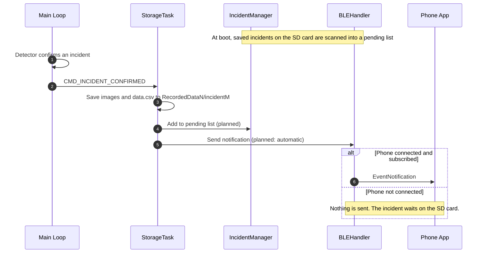
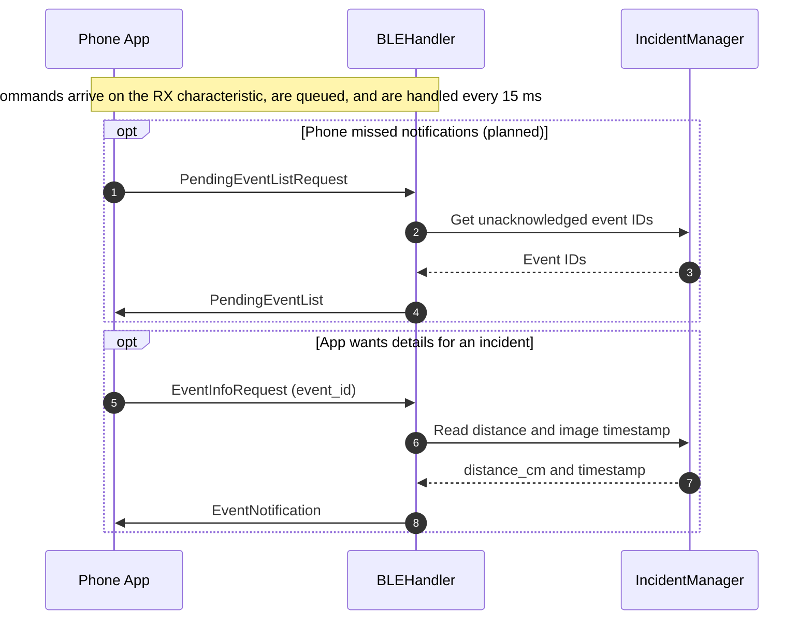
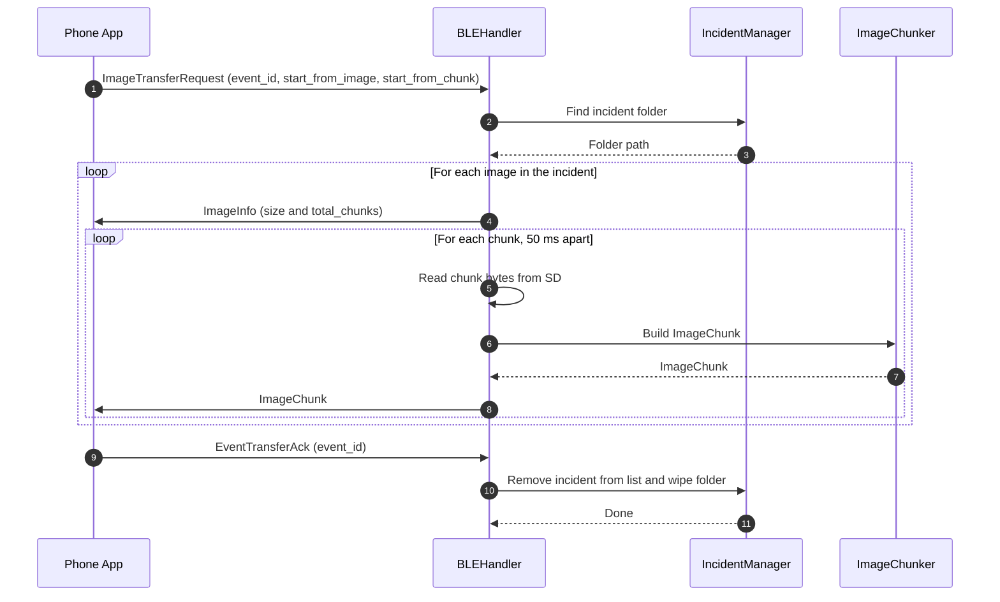

# bluetoothForHardwareTeam

## PlatformIO instructions

PlatformIO is a VS code addon currently it has an alien/bug icon and has verified ownership of platformio.org. The creator is also platformio.

### Initialization instructions

1) Install the PlatformIO extension in VS code (if it is not already on the machine).
2) Open the project at the root level (where the .ini file is).
3) Find the alien/bug icon on the side bar of VS code.
4) Click on the alien/bug icon.
5) Might need to wait a minute for the platformIO library to initialize and build elements that are in the git ignore. *might say there is no .ini file but give it 10 minutes tops before trying to relocate it.*
6) Ensure the seed_xiao_esp32_s3 section is there.
7) Celebrate project is initialized and can be built for the device.

### Loading it onto the device

1) Follow the Initialization instructions if you haven't already done so
2) Navigate to the seed_xiao_esp32_s3 section
3) If it is not already enlarged, enlarge it and the general section.
4) Connect the IBDC device to the computer through a usb connection.
5) Click 'Upload' or 'Upload and Monitor' under the seed_xiao_esp32_s3 > General panel in the PlatformIO Project Tasks.
6) Wait for confirmation of finished upload.
7) Upon confirmation the VS code terminal is no longer needed unless it is being used for monitoring.

### Developer Notes

There are build flags in sdkconfig.defaults that relate to the BLE interface. These can not be removed without causing the stack size to be reduced to 100 bytes or less for NimBLE resulting in a lot of crashes. With that said if someone was to edit platformio.ini, sdkconfig.defaults, sdkconfig.seed_xiao_esp32_s3, or a CMakeLists.txt then before the next upload they will need to do a full clean and build cycle. It is recommended that at this time they also comment out the line mentioned under the QOL update.

Note on **AUSTIN_COMPILES** Macro in IDBC.ino, beyond testing this macro should stay in 1 or be removed. The whole point of the macro is to allow a development board the use of a button to debug features in real time.

#### QOL update for PlatformIO

Comment out // managed_components > espressif_esp32-camera >driver >cam_hal.c line 299

#### Libraries necessary for development and loading

NimBLE is the library that is handling the bluetooth connection for the IDBC program.

NanoPB has a repository that will allow developers to convert a .proto file into a pb.c and a pb.h for NimBLE to process.

There are a lot of libraries associated esp_idf system and the alternative is arduino libraries or less effective memory optimizations that'll possibly cause a crash.

## Sequence Diagrams
Steps marked *(planned)* are the intended design and are not yet implemented.

### 1. Detecting and notifying (during a ride)



### 2. Reviewing incidents (user opens the app later)



### 3. Transferring images and cleanup



## Known Issues and Backlog

### Known Issues

| # | Issue | Behavior / Impact | Status |
|---|-------|-------------------|--------|
| 1 | Camera frame-buffer overflow | `cam_hal: FB-OVF` is logged, and the first `esp_camera_fb_get` capture times out, even right after a successful camera init. PSRAM is enabled (reports 8388608 bytes). | Open. Untried: lower XCLK, higher `jpeg_quality` number, `fb_count = 1`. |
| 2 | Capture failures are handled quietly, not fixed | A failed capture triggers a 30 s cooldown and rate-limited "queue full" logging so the storage task is not blocked or flooded. | Mitigation only; see #1 for the root cause. |
| 3 | No automatic resume after a mid-transfer disconnect | On disconnect or unsubscribe, the device aborts the active stream (verified on hardware). The image is sent again only when a new Transfer Image request arrives; the incident stays on the SD card until then. | By design for now. |
| 4 | Repeated trigger during a transfer | A second button press mid-stream sends another event notification while an image is still transferring. | Longer debounce added on one dev branch only; not a general fix. |
| 5 | Recorded-data folder with no image | Some recorded data folders contain no image. | Open (T#160). |
| 6 | Protobuf version mismatch | Generated `.pb.c/.h` files in firmware are v0.3.2. `IBDC_v0.3.3.proto/.options` exist. | Moving to v0.3.3 is pending approval. |
| 7 | File naming mismatch | `IDBC.ino` vs. `IBDC_v0.3.x.pb.*` | Rename once a new name is chosen. |

### Backlog / Deferred

- **Time sync (proposed):** a device/app time sync was proposed and marked "nice to have." For now, incident timestamps use the device's own millisecond counter. Clock request/response stubs are commented-out cases and are not reachable. The settings message catch is implemented.
- **Automatic incident detection without a button:** the intended end state. The current test flow uses a button, or a wire touched to the button pin on boards without one (`AUSTIN_COMPILES`).
- **Performance measurements:** baseline (T#169) and image transfer times (T#191) are not yet recorded. One image was observed taking about 16 s in a single test.
- **Buffer and stack tuning:** reduce BLE stack size and enlarge the image buffer (T#163, T#164).
- **Test programs:** incident manager, image chunker, and BLE handler (T#158, T#159, T#218).

## Image Chunker Demo

The Image Chunker demo demonstrates how an image is:

1. Read from a file as raw bytes.
2. Identified as JPEG or PNG.
3. Divided into 400-byte `ImageChunk` payloads.
4. Reassembled into the original byte sequence.
5. Verified to be byte-for-byte identical to the original image.

### Requirements

The demo is currently built and tested using GCC through MSYS2 UCRT64.

### Building

From the repository root, open an MSYS2 UCRT64 terminal and run:

```bash
gcc -Isrc/main/IDBC -Isrc/main/IDBC/Nanopb -c src/main/IDBC/ImageChunker.c -o ImageChunker.o
gcc -Isrc/main/IDBC -Isrc/main/IDBC/Nanopb -c src/main/IDBC/IBDC_v0.3.2.pb.c -o IBDC_v0.3.2.pb.o
gcc -Isrc/main/IDBC -Isrc/main/IDBC/Nanopb -c src/main/IDBC/Nanopb/pb_common.c -o pb_common.o
gcc -Isrc/main/IDBC -Isrc/main/IDBC/Nanopb -c src/main/IDBC/Nanopb/pb_encode.c -o pb_encode.o
gcc -Isrc/main/IDBC -Isrc/main/IDBC/Nanopb -c src/main/IDBC/Nanopb/pb_decode.c -o pb_decode.o
gcc -Isrc/main/IDBC -Isrc/main/IDBC/Nanopb -c src/main/IDBC/ImageChunkerDemo.c -o ImageChunkerDemo.o
gcc -Isrc/main/IDBC -Isrc/main/IDBC/Nanopb ImageChunkerDemo.o ImageChunker.o IBDC_v0.3.2.pb.o pb_common.o pb_encode.o pb_decode.o -o ImageChunkerDemo.exe
```

### Running

```bash
./ImageChunkerDemo.exe <input-image> <output-image>
```

----------------------------------------------------------------------------------------------------------------------------
